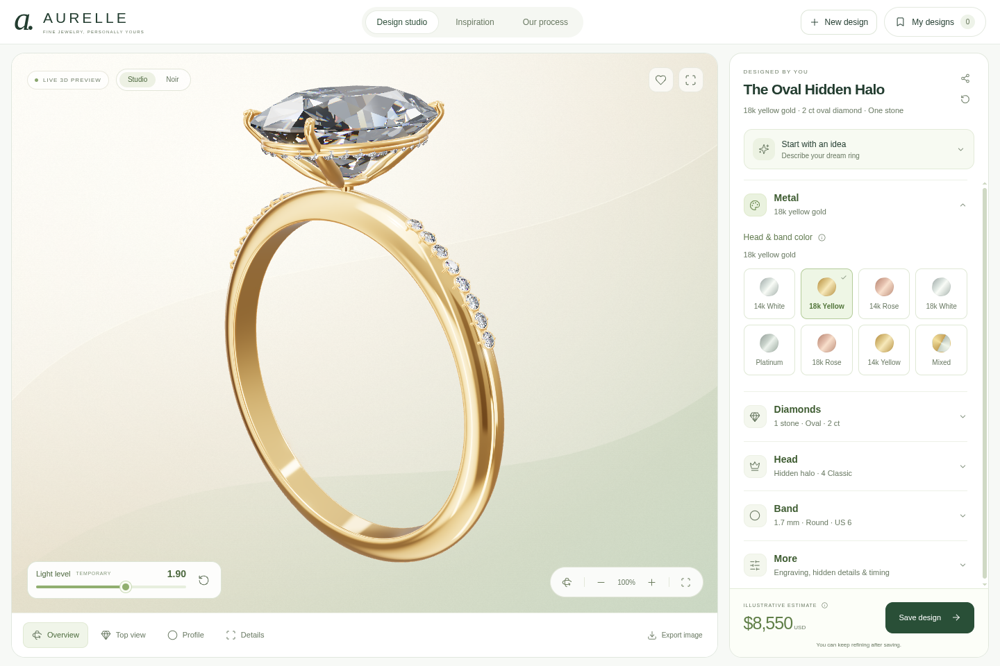

# Ring Maker 2.0

A responsive 3D ring-design application. The current interface uses Aurelle as placeholder branding.

## Open the app

Open **Aurelle Ring Studio.html** from the repository in Chrome, Edge, or Safari. The app and its 3D renderer are bundled into that single file. Internet is only used for optional display fonts; the application works offline.

The app begins with four questions. A refresh resumes the current ring in the same tab. Choose **New design**, **Inspiration**, or the Aurelle logo to repeat the welcome flow. Your saved designs remain available from **My designs**.

For development, install Node.js 20.19+ or 22.12+, then run `npm ci` and `npm run dev`. `npm test` runs the geometry, layout, and idle-motion checks. `npm run build` produces the static `dist` folder. `npm run standalone` regenerates **Aurelle Ring Studio.html** in the repository root, using `dist-standalone` for temporary build files.

## The four-step welcome

1. **Style and metal:** yellow, white, or rose gold; Solitaire, Halo, Hidden Halo, Bezel, Cathedral, Full Pavé, Toi et Moi, Three Stone, or Start from scratch. Style cards show actual 3D ring thumbnails, with an illustrated fallback when WebGL is unavailable.
2. **Center stone:** Natural or Lab Grown; Round, Oval, Cushion, Emerald, Princess, Asscher, Marquise, Pear, Radiant, or Decide later.
3. **Size:** 0.5, 1, 1.5, 2, 2.5, 3, 4, or 5 carats, or Decide later. Exact weights can be refined later in 0.05 ct increments. Side stones can be as small as 0.1 ct.
4. **Timing:** 1–4 weeks, 1–3 months, 3–6 months, or Not sure yet.

Back navigation preserves choices. Deferred stone choices remain explicitly marked in the designer while a sample stone is shown.

## The designer

- **Metal:** 14k White, 18k Yellow, 14k Rose, 18k White, Platinum, 18k Rose, 14k Yellow, or Mixed. Mixed reveals independent head and band metals.
- **Diamonds:** one, two, or three stones; independently editable shape and carat weight for every stone; Natural, Lab Grown, or Skip origin preference.

- **Head:** None, Basket, Halo, Hidden Halo, or Bezel; 4 Classic, 4 Compass, or 6 Prong; Claw, Petite Claw, Rounded, or Tab tips; plain or pavé prong arms. Three-stone arrangements use a supporting basket in place of None. Bezel settings hide visible prongs and disable the prong controls while preserving their values. Two-stone rings offer Tiered and Level set elevation.
- **Band:** Round or Square profile; optional Cathedral shoulders; None or Petite French pavé, with shoulder or full-band coverage; 1.5–4 mm width; US/Canada sizes 3–13 in quarter sizes; Comfort Fit or Standard Fit.
- **More:** engraving up to 14 characters; Block or Cursive lettering; surprise stones; editable timing preference; matching wedding band.

Two-stone designs start with matching cuts and carat weights. The second stone follows edits to the center stone until you customize it separately. The **Match center stone** button in the second stone's editor restores the matching pair. Saved and exported designs retain independently chosen second stones.

Three-stone designs start with a raised center and two smaller matching round sides, approximately 30% of the center's carat weight each. A 1 ct center starts with two 0.3 ct sides. The preset includes baskets and cathedral shoulders. Automatic sides follow center-size changes. Editing the left stone updates the matching right stone until the right is customized independently. **Use balanced side stones** restores the default proportions, and **Match left stone** restores a matching pair. Existing automatic 0.5 ct side defaults migrate to the balanced arrangement; explicit independent stone choices are preserved. Design links update as the ring changes, so refreshing an edited shared design keeps those edits.

Geometry, metal finishes, band dimensions, engraving, and hidden details update in the 3D preview. The ring can be rotated, zoomed, viewed from preset angles, expanded, and downloaded as a PNG.

Metal and diamonds use the same asymmetric studio layout, with their own reflection treatments. Broad graduated silk panels illuminate the curved inner and outer shank, while narrow bright strips and darker reflection cards create moving highlights and richer warm shadows. The metal retains its conductor tint without a white clear coat. The near band surface correctly hides the far side, and the preview, welcome thumbnails, and downloads have no ground or drop shadow.

Yellow gold uses calibrated linear reflection colors, with a softer 14k tint and a warmer 18k tint. Amber midtones and creamy highlights replace the more saturated yellow/brass response. Lower reflection intensity balances the selected 1.90 lighting, and a slightly sharper polish keeps the highlights clear. These adjustments apply only to the gold material; the diamond shader, its mount tint, lighting, and sparkle remain unchanged. All metals retain a slight frost: fine continuous grain varies surface roughness and gently perturbs reflected highlights, with a polished base that preserves clear reflections. The grain works without UV coordinates and fades below pixel size to limit shimmer. It applies to the shank, prongs, galleries, mixed metals, and wedding bands. Larger previews use a 1024-pixel reflection cube; smaller previews use 512 pixels.

Diamond lighting leaves darker space between the bright studio panels so individual facets stay legible. The optical shader traces three wavelengths through the closed cut, using exact Fresnel equations at both interfaces and total internal reflection. It follows up to eight internal bounces and collects environment light only when a ray exits the stone; unresolved internal rays no longer add an artificial gray light floor. The selected **1.90** exposure remains the default. This separates bright reflections, darker facets, and restrained rainbow fire without lowering the whole scene's lighting.

The open Solitaire setting follows a V-shaped profile: rounded prong arms rise from one common foot embedded in the band, curve around the pavilion, and curl into the selected tips. Its standard prongs have fuller bodies and larger tips, while Petite Claw retains a finer profile. The Round band has fuller outer shoulders within the selected width and ring size. Prong pavé follows the surface of the broader arms. The former short stem, flat lower seat, and crossbars are removed from this head. The diamond is raised enough to leave a clean opening beneath its culet. Single-stone designs with **Basket & Halo: None**, including pavé variants, use this construction. Basket, halo, bezel, and multi-stone heads retain their existing geometry. Cut, carat, prong count, tip style, and prong pavé remain editable. The gold finish, diamond optics, and selected 1.90 lighting are unchanged.

Metal edges use continuous rounded contours: Round bands have domed sides and rolled inner edges, while Square bands keep flatter profiles with softened corners. Comfort-fit interiors curve smoothly, and engraving follows the inner surface. Prongs blend from a narrow common seat into fuller curved bodies, then taper into shaped claws proportioned to each stone. Small side stones retain finer prongs. Rounded exposed ends and softened Tab tips avoid abrupt metal corners; diamond facets remain crisp.

The warmer photographic backdrop, view-dependent edge glints, and automatic framing use the actual ring vertices. **Diamond detail** provides a close-up of the stones and setting. Size changes and two/three-stone designs are reframed to fit. PNG downloads render at twice the current resolution, capped at 3200 pixels on the longest edge, then restore the live rendering resolution.

The diamond's crown junctions retain their individual facet normals. Four fixed sources drive the edge flashes, and small bright sources add internal flashes through the optical shader. Sparkle follows the viewing angle rather than blinking on a timer.

The ring slowly turns after 3.5 seconds without interaction, easing up to one revolution in roughly 143 seconds. Dragging, touching, scrolling, typing, changing an option, or choosing a view pauses the turn. It resumes after the next quiet interval. The rotation button can pause it indefinitely or enable it again. Dialogs, the welcome flow, an unfocused/hidden tab, and an offscreen preview pause automatic motion. Reduced-motion preferences start the preview still, with an explicit rotation opt-in. Welcome thumbnails remain still. Idle framing fits a complete revolution and eases into that framing, keeping the ring large and visible without repeatedly zooming during a turn.

The preview offers **Studio** and **Noir** backgrounds. Studio is the default bright ivory presentation; Noir provides a dark gallery backdrop with brighter controls. The selection is remembered in the current browser tab and carried into downloaded PNGs. It changes the presentation background rather than the customer's ring specification.

## Reference-informed graphics

The ring stays upright on the vertical turntable axis, with no built-in sideways or forward lean. Manual orbiting, preset views, welcome thumbnails, idle rotation, and image exports use the same upright model orientation.

The [Seven Oaks reference](https://sevenoaksjewelers.com/pages/custom-ring-builder) embeds a JewelerOS designer. This app independently recreates useful visual behavior rather than embedding that vendor's renderer or copying its models.

- **Stone profiles:** the round benchmark has a 54% table and approximately 61% total depth. Brilliant cuts use crown stars and pavilion kites; step cuts use distinct gallery-like facets. Elongated shapes have their own length, width, and depth proportions. The closed rendered geometry is also the volume traced by the optical shader.
- **Consistent scale:** estimated stone dimensions, band width, and ring diameter share one world scale. Carat changes follow cube-root dimensional scaling. The stone editor shows an approximate footprint and depth, updated when the cut or weight changes. These preview dimensions do not replace supplier measurements.
- **Fitted settings:** pavilion depth sets the height above the band, and large stones no longer sink into it. Halo and bezel clearance contributes to two- and three-stone spacing. Prongs follow clipped corners or pointed ends; tapered arms join shaped claws, rounded tips, or softened tabs.
- **Connected construction:** bezels are solid rounded walls. Baskets have multiple gallery rails, halo seats have support spokes, and small pavé stones have retaining grains. Halos use arc-length spacing with overlap checks. Hidden halos sit beneath the stone's edge. Cathedral shoulders meet the outer settings on multi-stone designs.
- **Integrated layouts:** side pavilions are seated above the local curved shank rather than a shared global height. Continuous front and rear galleries join multiple baskets; outer stones are supported by shoulders instead of isolated pegs. Side stones tilt outward around the raised center. Shoulders begin inside the shank and follow its tangent, with tapered rounded sections. Bezel walls have a softer flared contour and stronger curved supports. Pavé follows raised shoulders and checks spacing against stones on the base band.
- **Presentation:** graduated softboxes create moving reflections without broad flat light patches. Higher-resolution metal reflections and diamond rays use a common studio layout, with extra strip cards for polished metal. The large preview and macro view use a slightly longer product-photo perspective. Table-edge glints follow each cut's crown height.

## Interface

A temporary **Light level** slider appears in the preview for tuning the presentation. Its displayed value is the renderer's exact exposure setting: **1.90** is the chosen default, with a range of **0.20–3.00** in **0.05** increments. It changes the ring lighting live, pauses idle rotation during adjustment, applies to image exports, and is remembered in the browser tab. Reset returns to 1.90. Older tab settings adopt the chosen default once, then retain further adjustments. It is a preview preference rather than a saved ring specification or pricing option.

The designer fills the available screen beneath a compact header. A large ring preview sits beside a narrower options panel, with the ring name and details inside that panel. The default camera fills more of the preview while keeping the complete design visible. **New design** is in the header. On phones the preview is taller, and its **Options** button jumps to customization.

The Studio and Noir backgrounds use a softly lit paper texture with sweeping curves and fine, stationary grain. The same background appears in PNG exports and works offline. There is no ground shadow beneath the ring.

The interface uses visual metal tiles, shape illustrations, and expandable sections that show live summaries of the current selections. One customization section is expanded at a time. The optional description tool opens from **Start with an idea**. Desktop controls scroll within the panel, while the Save action stays visible. On phones, the Save action is pinned to the bottom of the screen and is hidden while the welcome flow is open. The preview, four-step welcome, stone editor, saved-design dialogs, Studio/Noir controls, and image exports share the updated visual design.

## Keeping a design

Designs save locally in the browser. JSON design files can be exported and imported to move between devices, browsers, the standalone file, and a hosted app. Earlier Aurelle v1 design files and saved designs are migrated to the expanded controls. New exports use the `aurelle-ring-v2` format and retain all options, including timeline and deferred choices. Web links recreate the full design when the application is hosted.

## Prototype boundaries

Prices are illustrative. Inventory, real quotes, accounts, cloud storage, production scheduling, checkout, and payments are not connected. Timing is a design preference, not a delivery promise. The description tool is a local keyword parser for available options, not a generative AI service.

The models are visual concepts rather than manufacturing CAD. Diamond origin preferences share the same preview appearance. Skip leaves origin undecided and uses the lab-grown rate for the illustrative estimate. Deferred carat sizes use the preview stone's weight in the estimate. Engraving is a curved surface texture, not an engraved manufacturing model. Cursive lettering uses installed system script fonts with a generic fallback.

## Verification

The production and standalone builds passed. Browser checks cover all four welcome steps, backward navigation, all nine cuts, sizes through 5 ct, timing, independent stones, mixed metals, head/prong controls, full pavé, band width and size, fit, engraving, surprise stones, matching bands, session restoration, saving, JSON export/import, PNG downloads, and layouts from 320 to 1920 pixels. Shader compilation and runtime errors are checked while rendering the combined options.

`npm test` checks front/back visibility using actual ray intersections for Round and Square profiles, both fits, and the matching wedding band. It also verifies continuous shading at both closed band seams across narrow and wide profiles. Lighting checks also cover several rotation angles, side/top views, four metal finishes, image export, and mobile rendering.

Geometry checks cover every cut's optical volume and preview dimensions, carat scaling, pavilion clearance for small/large and multiple stones, non-overlapping halos, room for adjacent halo/bezel heads, front-facing solid bezel walls and cathedral shoulders, and complete cathedral construction with each head style and stone count. Browser checks require non-empty rendered previews as well as error-free controls.

The connected-setting pass adds checks for balanced trilogy defaults, lower side-stone seating, short central mounts, linked and independently edited sides, legacy defaults, and level/tiered table heights. The eight presets plus an equal-stone trilogy are reviewed in front and overview views. Browser checks cover the welcome and stone-count entry paths, 0.1 ct side-stone controls, saved custom side stones, restoring matching/balanced sides, all nine cuts with varied head/band settings, mobile rendering, and PNG export.

Idle-motion tests cover the delay, gradual start, held pointers, multiple contacts, manual pause, and overlapping visibility/modal pauses. Browser checks verify actual changing pixels, immediate contact pauses, drag/zoom, quiet-time resumption, preset views, modal dismissal, focus, reduced-motion changes, explicit opt-in, and offscreen mobile behavior. A complete-turn framing audit checks 24 azimuths across five designs, three views, and desktop/mobile widths. A sparkle audit compares the previous and new edge glints at 64 angles across four cuts and checks shader errors.

The reflection audit isolates metal and gemstone pixels in sixteen renders: four metals at four rotation angles. It compares white-highlight coverage, low and high brightness percentiles, and average brightness against the previous treatment, and checks for dark gemstone regions and shader errors. The lighting retains the controlled highlights while giving the lower reflections more depth.

The mirror-polish pass repeats that audit against the prior sparkle treatment. It checks clearer reflection contrast, retained yellow-gold saturation, controlled white highlights, and bright gemstone interiors, with browser coverage for all cuts, mixed metals, image exports, and small screens.

The latest reference comparison checks nine style arrangements in front and overview views, all nine cuts with combined settings, mixed metals, mobile rendering, and PNG exports. Four fancy cuts are also reviewed in top and close-up views. Isolated renders of four metals at four angles verify richer metal reflections and stronger gemstone facet contrast, while retaining the 1.90 exposure and subtle frost.

The solitaire update adds geometry checks across all nine cuts, 0.5/5 ct sizes, and all prong counts: the arms must join the shank through a narrow common foot and leave the pavilion clear. Browser review covers each cut at both sizes, all prong counts and tips with pavé, and front/side/overview angles. A geometry comparison verifies that six other setting styles retain identical meshes.

The HDR post-processing and optics pass adds transparent-safe 4× MSAA rendering with multi-bounce metallic crevice occlusion and tight optical bloom, dedicated Noir gallery reflections, overhead diamond contrast, 5-band spectral dispersion, bezel-enclosure reflections, rotated 6-ray aperture glints, linear alloy calibration for rose/white/platinum metals, smoother solitaire prong curves with seamless claw joints, and recessed French pavé collars. Browser verification covers welcome thumbnails, overview/detail/top angles, Studio and Noir modes, rose/yellow/platinum metals, bezel/solitaire/halo/trilogy layouts, and high-resolution PNG export without shader or runtime errors.

## Source layout

`src/config.js` defines design state, presets, validation, migration, and illustrative estimates. `src/welcome.js` implements the four-step flow and ring thumbnails. `src/inspector.js` renders the five expandable sections. `src/gem-proportions.js` defines the shared scale and estimated cut dimensions; `src/setting-geometry.js` defines fitted layouts, offset outlines, prong placement, solid bezels, and claw shapes. `src/ring-model.js` builds the physical design details; `src/ring.js` manages framing, viewing, surface lighting, and image export; `src/post-fx.js` provides transparent-safe HDR multi-bounce crevice occlusion and optical bloom; `src/idle-rotation.js` coordinates idle motion and interaction pauses; `src/metal-finish.js` adds the filtered satin grain and calibrated metal response; `src/studio-lighting.js` defines the shared Studio and Noir environments; `src/diamond.js` contains the cut geometry and 5-band optical shader; `src/diamond-glints.js` adds view-dependent 6-ray optical flares at crown junctions. `src/ui.css` defines the modern responsive interface. `src/main.js` connects the application and design library. No API keys or additional services are required.
